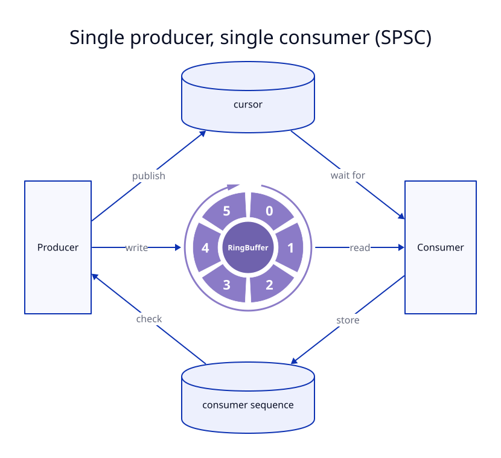

# godisruptor

A Go implementation of the [LMAX Disruptor](https://lmax-exchange.github.io/disruptor/), a way to hand events from one goroutine to another through a preallocated ring buffer. This version is single producer, single consumer (SPSC).

<p align="center"></p>

The ring buffer is allocated once and reused. The producer and the consumer never call each other. They coordinate through two counters, each written by exactly one side: the cursor, which is the last sequence the producer has published, and the consumer sequence, which is the last sequence the consumer has read. A sequence only grows, and it maps to a slot of the ring with `sequence % size`, which is what makes the ring circular.

To send an event, the producer writes it into the next slot and publishes it, which moves the cursor. The consumer waits until the cursor reaches the sequence it wants, reads the event from the ring, and then stores its own sequence. Before the producer reuses a slot it checks the consumer sequence, so it never overwrites an event that has not been read.

## Build

Go 1.26 or newer, and nothing beyond the standard library.

```bash
go vet ./...
go test ./...
go test -race ./...
```
